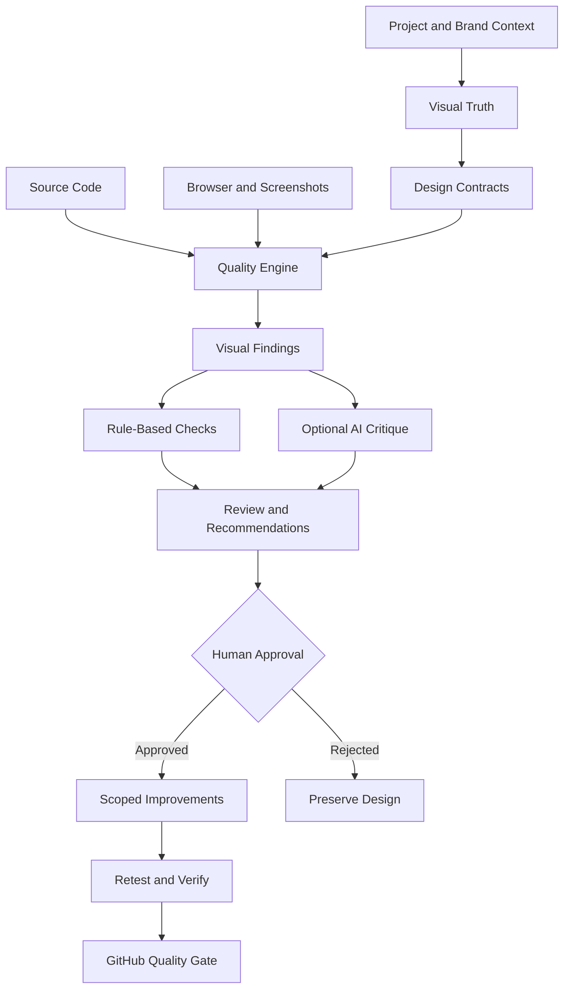

 <div align="center">

# ✦ VISUAL DIRECTOR UX

### Design Intelligence. Visual Consistency. Verified Experiences.

**An AI-powered visual direction and design quality system.**

Built for creators, designers, frontend engineers, and AI coding agents.

**Created by [STARBOTS](https://starbots.dev)**

*Give intelligence a role. Give design a direction.*

<br/>


<br/>

[](https://starbots.dev)
[](https://github.com/Starbots-devv)
[](https://www.linkedin.com/company/starbotss/)
[](https://www.instagram.com/starbots.dev/)
[](https://x.com/starbotsdev)
[](https://discord.gg/PekabyrTN)

<br/>

**[Overview](#-overview) · [Capabilities](#-core-capabilities) · [Architecture](#-system-architecture) · [V-DLC](#-visual-design-lifecycle) · [Roadmap](#-development-roadmap) · [Community](#-starbots-community)**

</div>

---

## 🚀 Overview

**Visual Director UX** is an open-source, AI-powered visual direction and quality governance system designed to help teams create, evaluate, refine, and maintain professional digital experiences.

Modern development tools can generate impressive interfaces in seconds.

But generating an interface is not the same as creating a cohesive product.

A beautifully designed component can still feel out of place. A perfectly functional page can have poor hierarchy. A small styling change can introduce inconsistencies across an entire application.

**Visual Director UX is being built to solve that problem.**

Instead of treating design quality as a final review, we want to make visual intelligence a continuous part of the development lifecycle.

Our goal is simple:

> **Every component should belong. Every screen should communicate. Every design decision should have a purpose.**

Visual Director aims to become an intelligent design supervisor that understands how a product should look, compares that intent with what has actually been built, and helps developers improve their work.

### Our vision

Create an AI-powered system capable of acting as a **Visual Design Director** for digital products.

A system that understands:

- What colors belong to a brand.
- Which typography styles should be used.
- Where visual elements should appear.
- How content should be structured.
- Which components are approved.
- How spacing, alignment, and proportions should behave.
- Whether different pages share a consistent visual language.
- How an interface should adapt across devices.
- Whether an animation improves or harms an experience.
- When a visual decision should be preserved rather than redesigned.

**Not just an AI that generates UI. An AI that understands design direction.**

---

## 💡 Why Visual Director?

AI coding agents, UI libraries, and modern frontend frameworks have made software development dramatically faster.

However, one challenge remains:

**Design consistency does not happen automatically.**

A project can easily end up with:

| Problem | Visual Director's intended approach |
|---|---|
| Inconsistent colors | Brand-aware design token enforcement |
| Different button styles | Approved component registry |
| Random typography sizes | Semantic typography and hierarchy rules |
| Poor spacing | Layout and spacing contract validation |
| Unbalanced compositions | AI-assisted visual critique |
| Broken mobile layouts | Responsive inspection and browser testing |
| Elements overlapping | Layout and overflow detection |
| Accessibility issues | Automated checks and manual review guidance |
| Visual drift between pages | Cross-page consistency analysis |
| Unexpected redesigns | Approved visual baselines and protected compositions |
| Unclear design decisions | Explainable findings and recommendations |
| Repeated UI mistakes | Reusable policies and automated quality gates |

Our ambition is to transform design quality from a subjective last-minute task into a **structured, repeatable, and measurable engineering process**.

---


## 🧠 The Three Intelligence Layers

Visual Director is designed around three interconnected systems.

### 01 — Visual Truth

**The source of truth for your product's design.**

This layer defines what your product should look and feel like.

Planned capabilities include:

- Brand identity profiles.
- Semantic color tokens.
- Typography systems.
- Spacing and sizing scales.
- Approved component variants.
- Layout and composition contracts.
- Responsive behavior rules.
- Animation and motion guidelines.
- Brand-specific visual effects.
- Approved reference screenshots.
- Protected design compositions.
- Theme-specific requirements.
- Design decisions and exceptions.

Each project can have its own identity.

A fintech dashboard should not inherit the same visual language as a creative agency website.

**Visual Director should respect the product's identity, not impose a generic one.**

### 02 — Quality Engine

**The system that inspects what has actually been built.**

Planned inspections include:

- Source code analysis.
- CSS and design token audits.
- Component usage validation.
- Typography consistency checks.
- Browser-based UI inspection.
- Responsive layout testing.
- Accessibility analysis.
- Visual regression detection.
- Screenshot comparisons.
- Navigation and interaction checks.
- Theme consistency validation.
- Cross-page design drift detection.
- Performance-aware motion auditing.
- Component state verification.

The Quality Engine should produce reproducible evidence rather than vague judgments.

### 03 — Agent Workflow

**The intelligence that turns findings into improvements.**

Planned capabilities include:

- AI-assisted design critiques.
- Explainable design findings.
- Actionable correction suggestions.
- Developer and agent guidance.
- Dry-run repair proposals.
- Reusable visual policies.
- GitHub Pull Request reports.
- Human approval workflows.
- Automatic re-testing.
- Integrations with AI coding agents.

**Design decisions remain human-controlled.**

Visual Director should help creative teams make better decisions, not silently override their work.

---

## ✨ Core Capabilities

### 🎨 Brand Intelligence

Define a visual identity and help maintain it throughout a project.

Planned features:

- Brand profiles and design guidelines.
- Custom color palettes and semantic tokens.
- Font families and typography roles.
- Shadow, border, radius, and spacing systems.
- Dark and light mode policies.
- Iconography consistency.
- Approved visual effects.
- Component styling conventions.

### 📐 Layout & Composition Intelligence

Help developers understand not only which components to use, but **where and why to use them**.

Planned features:

- Visual hierarchy analysis.
- Section structure and placement.
- Content alignment.
- Grid and container consistency.
- Whitespace distribution.
- Heading and subtitle relationships.
- CTA placement.
- Component density analysis.
- Desktop and mobile layout contracts.
- Visual balance recommendations.

A page should not simply contain the right elements.

**Those elements should be organized with intention.**

### 🧩 Component Governance

Create consistency across applications without limiting creativity.

Planned features:

- Approved component registry.
- Component variant policies.
- Button and input consistency.
- Card and container standards.
- Shared navigation guidelines.
- Detection of duplicated UI patterns.
- Source and license tracking.
- Approved exceptions for signature experiences.

Visual Director is intended to work alongside existing design systems and component libraries.

It does not aim to replace them.

### 👁️ Visual Inspection

Analyze actual rendered interfaces through browser-based evidence.

Planned features:

- Screenshot capture.
- Responsive viewport inspection.
- Overflow and clipping detection.
- Visual change highlighting.
- Before-and-after comparisons.
- Theme-specific inspection.
- Component state testing.
- Page-to-page visual consistency.

### ♿ Accessibility & UX Quality

Good design must also be usable.

Planned capabilities:

- Keyboard navigation checks.
- Focus visibility verification.
- Accessible name validation.
- Heading hierarchy checks.
- Contrast analysis.
- Interactive element inspection.
- Touch target evaluation.
- Reduced-motion compatibility.
- Mobile usability checks.

Automated accessibility testing complements, but does not replace, human evaluation.

### 🌊 Motion & Effects Direction

Animations should support the experience rather than distract from it.

Visual Director aims to provide guidance for:

- Motion hierarchy.
- Transitions and microinteractions.
- Glassmorphism.
- Liquid effects.
- Blur and gradient effects.
- Glow and lighting.
- Scroll-triggered motion.
- Parallax.
- Loading states.
- Reduced-motion alternatives.
- Performance-conscious animation.

Signature visual moments should remain expressive.

Everyday UI should remain clear and usable.

### 🤖 AI-Powered Creative Review

An optional AI layer is planned to help teams evaluate visual decisions.

Potential capabilities:

- Review screenshots against approved references.
- Explain issues with hierarchy and visual balance.
- Identify potential design inconsistencies.
- Recommend alternative layouts.
- Suggest improvements to component composition.
- Compare design directions.
- Explain why a proposed change may improve UX.

**Important:** AI-generated creative feedback is advisory. It is not an objective measurement of beauty.

### 🛠️ Smart Repair Planning

Visual Director aims to help developers fix issues rather than merely report them.

Planned capabilities:

- Identify the affected component.
- Explain the violated design rule.
- Provide supporting evidence.
- Recommend approved tokens or components.
- Suggest scoped changes.
- Support dry-run corrections.
- Re-run the relevant tests.
- Request approval for creative or potentially risky modifications.

---

## 🔄 How Visual Director Should Work



### The intended workflow

**Discover → Define → Inspect → Analyze → Improve → Verify → Evolve**

Visual Director should first understand the project and its approved visual direction.

Only then should it analyze the implementation and suggest improvements.

The system should never assume that a visual difference is automatically an error.

---

## 🧪 Example Visual Audit

*Illustrative output — not a claim of functionality already released.*

```text
╭────────────────────────────────────────────╮
│                                            │
│        VISUAL DIRECTOR UX                  │
│        Intelligent Visual Review           │
│                                            │
╰────────────────────────────────────────────╯

PROJECT:  Example Application
ROUTE:    /solutions
THEME:    Dark
VIEWPORT: 390 x 844

━━━━━━━━━━━━━━━━━━━━━━━━━━━━━━━━━━━━━━━━━━━━━━

[ERROR] COLOR-002

Unapproved primary button color.

Expected:
  Approved brand action token

Detected:
  Local hard-coded color

Recommendation:
  Use the official primary button variant.

━━━━━━━━━━━━━━━━━━━━━━━━━━━━━━━━━━━━━━━━━━━━━━

[WARNING] TYPE-004

Inconsistent section heading hierarchy.

Recommendation:
  Apply the approved SectionHeading role.

━━━━━━━━━━━━━━━━━━━━━━━━━━━━━━━━━━━━━━━━━━━━━━

[ERROR] LAYOUT-006

Horizontal overflow detected on mobile.

Recommendation:
  Review container width and responsive grid.

━━━━━━━━━━━━━━━━━━━━━━━━━━━━━━━━━━━━━━━━━━━━━━

AUDIT SUMMARY

2 Errors
1 Warning

Status: Review required

━━━━━━━━━━━━━━━━━━━━━━━━━━━━━━━━━━━━━━━━━━━━━━
```

The long-term goal is to provide useful evidence with every report:

- Rule identifier and severity.
- Route and viewport.
- Affected element or source location.
- Expected and actual behavior.
- Screenshots when relevant.
- Recommended correction.
- Verification status.

No check should report success if it did not actually run.

---

## 🏗️ System Architecture

Visual Director is planned as a modular system that can evolve independently.

```text
Visual Director UX
│
├── Core Engine
│   ├── Configuration
│   ├── Rule Definitions
│   ├── Visual Contracts
│   ├── Findings
│   └── Policy Exceptions
│
├── Brand Intelligence
│   ├── Brand Profiles
│   ├── Design Tokens
│   ├── Typography
│   ├── Component Registry
│   └── Visual Guidelines
│
├── Source Inspector
│   ├── TSX / React Analysis
│   ├── CSS Analysis
│   ├── Token Validation
│   └── Component Governance
│
├── Browser Inspector
│   ├── Playwright
│   ├── Responsive Audits
│   ├── Accessibility
│   ├── Interaction Testing
│   └── Screenshots
│
├── Visual Intelligence
│   ├── Visual Regression
│   ├── Cross-Page Consistency
│   ├── Composition Review
│   └── Optional AI Critique
│
├── Developer Experience
│   ├── CLI
│   ├── MCP Integration
│   ├── Agent Skills
│   └── Audit Reports
│
├── GitHub Integration
│   ├── Pull Request Checks
│   ├── Quality Gates
│   └── Review Evidence
│
└── Visual Review Workspace
    ├── Findings Dashboard
    ├── Before / After
    ├── Approved Baselines
    └── Design History
```

**This is the target architecture. Individual modules will become available progressively.**

---

## 🪐 Visual Design Lifecycle — V-DLC

Visual Director follows a proposed staged approach to visual engineering.

We call it the **Visual Design Lifecycle (V-DLC)**.

Its purpose is to introduce visual quality controls throughout development instead of waiting until the interface is finished.

| Phase | Name | Purpose |
|---|---|---|
| V0 | Discover | Analyze the product, framework, components, and existing styles |
| V1 | Define | Establish brand direction, contracts, and approved references |
| V2 | Architect | Design the verification strategy and required integrations |
| V3 | Construct | Implement and test the visual quality rules |
| V4 | Operate | Audit interfaces, inspect changes, and maintain consistency |
| V5 | Evolve | Improve approved rules, baselines, and design standards |

### Our philosophy

**Requirements → Visual Contracts → Implementation → Inspection → Evidence → Review → Release**

Every approved design decision should be traceable.

Every automated finding should be explainable.

Every important change should be reviewable.

V-DLC is Starbots' proposed visual-governance workflow, not an official implementation of another AI development methodology.

---

## 🔌 AI Agent Integrations

Visual Director is intended to be compatible with modern AI coding workflows.

| Platform | Planned integration |
|---|---|
| **Claude Code** | Design rules, visual audits, agent skills, and improvement guidance |
| **OpenAI Codex** | Shared visual contracts, code inspection, and verification workflows |
| **Kiro** | Project-aware visual quality controls and development guidance |
| **GitHub Actions** | Pull Request checks and automated visual quality gates |
| **Playwright** | Browser inspection, screenshots, and responsive testing |
| **Storybook** | Component documentation and state validation |
| **Figma** | Optional integration with approved design references |
| **Impeccable** | Complementary design review and frontend quality expertise |
| **MCP** | Future standardized interface for authorized agent interactions |

Our ambition is to create a **unified visual quality layer** that works across different development environments.

One source of visual truth.

Multiple agents.

Consistent results.

---

## 🧰 Compatible Design Ecosystem

Visual Director is designed to complement the tools developers already love.

Examples of component and design ecosystems we intend to evaluate include:

| Ecosystem | Role |
|---|---|
| [shadcn/ui](https://ui.shadcn.com/) | Reusable UI components and design-system foundations |
| [UI Layouts](https://github.com/ui-layouts/uilayouts) | Creative UI patterns and interactive components |
| [21st.dev](https://21st.dev/) | Component discovery and design inspiration |
| [Motion](https://motion.dev/) | Animation and interaction |
| [React Bits](https://reactbits.dev/) | Interactive UI and motion components |
| [Animate UI](https://animate-ui.com/) | Animated React components |
| [Radix UI](https://www.radix-ui.com/) | Accessible primitives |
| [Tailwind CSS](https://tailwindcss.com/) | Utility-first styling |
| [Playwright](https://playwright.dev/) | Browser automation and UI verification |
| [axe-core](https://github.com/dequelabs/axe-core) | Accessibility analysis |

These are examples of compatible or potential integration targets, **not a list of dependencies bundled with Visual Director**.

Each integration will be evaluated for usefulness, compatibility, licensing, security, and maintenance.

---

## 🎯 Who Is It For?

### Frontend Developers

Maintain consistent interfaces and identify UI issues earlier.

### UI/UX Designers

Protect approved design decisions and improve the handoff between design and engineering.

### AI Coding Agents

Use structured design policies to generate, inspect, and improve interfaces without ignoring project-specific visual direction.

### Product Teams

Review visual changes, maintain design-system consistency, and reduce unexpected UI regressions.

### Creators and Independent Builders

Develop more cohesive digital experiences without rebuilding visual guidelines for every new project.

### Agencies and Design Systems Teams

Reuse design quality workflows across multiple client projects while preserving each brand's identity.

---

## 🗺️ Development Roadmap

**Current stage: Early Development / Pre-alpha**

This repository is being developed incrementally. Features below represent the target scope and are not all implemented.

| Milestone | Objective | Status |
|---|---|---|
| U1 — Core Engine | CLI, schemas, design tokens, component and typography rules | In development |
| U2 — Browser Inspector | Responsive testing, interaction and accessibility audits | Planned |
| U3 — Visual Intelligence | Screenshots, baselines, visual regression and design consistency | Planned |
| U4 — GitHub Quality Gates | Pull Request reports, automated checks and evidence | Planned |
| U5 — Agent Integrations | MCP, Claude Code, Codex, Kiro and optional AI critique | Planned |
| U6 — Visual Review Workspace | Review interface, before/after comparisons and approval history | Future |
| U7 — Creator Workflows | Broader visual composition and creative asset workflows | Exploratory |

Our initial development focus is **reliable, testable rules with reproducible evidence**.

Advanced AI critique and visual dashboards will be built on top of a validated foundation.

---

## 🖥️ Planned Developer Experience

We want Visual Director to be useful from a terminal, an AI coding agent, or a CI pipeline.

The following commands are **illustrative and not available as a stable CLI yet**:

```bash
# Inspect project configuration
svd doctor

# Analyze source code
svd scan --source ./src

# Run browser-based UI checks
svd audit --base-url http://localhost:3000

# Review visual differences
svd compare --baseline-dir ./visual-baselines

# Validate design contracts
svd contracts validate

# Explain a specific finding
svd explain --finding FINDING_ID
```

Installation instructions and runnable examples will be published with the first tested release.

We will not advertise unfinished commands as functional software.

---

## 🔐 Security & Privacy

Visual Director is intended to follow a security-conscious, local-first architecture.

Our design principles include:

- Local analysis wherever possible.
- No mandatory external AI subscription for deterministic checks.
- Opt-in AI integrations.
- No collection of project secrets.
- Explicit approval before sharing screenshots or source code with external services.
- Scoped browser access.
- Least-privilege GitHub integrations.
- Human approval for destructive actions and creative redesigns.
- Reproducible reports and transparent failure states.
- Clear separation between project data and optional telemetry.

**Project privacy and ownership are fundamental requirements.**

---

## ✅ Quality Standards

The first usable release should demonstrate its capabilities with real tests.

Examples of expected verification criteria:

- A deliberately incorrect color token produces a finding.
- An approved color token passes the same check.
- Invalid component variants are detected.
- Typography rules identify documented violations.
- Approved exceptions are respected.
- Reports include meaningful evidence.
- Scanner errors are not reported as successful audits.
- Tests can run reproducibly in supported environments.

A design quality tool should be held to the same quality standards it expects from other products.

---

## 🤝 Contributing

We welcome ideas, feedback, and future contributions from developers, designers, accessibility specialists, and AI engineering enthusiasts.

Useful contributions include:

- New visual quality rules.
- Reproducible UI bug cases.
- Accessibility testing ideas.
- Brand and design-system governance patterns.
- Integration proposals.
- Test fixtures and examples.
- Documentation improvements.
- UX research and feedback.

As the project matures, we will publish more detailed setup instructions, contribution guidelines, and stable APIs.

For now, use GitHub Issues to discuss ideas and feature requests.

**When proposing a rule**, describe the problem it should detect, the expected result, possible exceptions, and how the behavior could be tested.

---

## ❓ Frequently Asked Questions

**Is Visual Director a website builder?**

No. It is being developed as a visual direction, auditing, and governance layer for existing development workflows.

**Does it replace designers?**

No. It supports designers and developers by making design decisions more consistent and easier to verify.

**Will it work with Claude, Codex, and Kiro?**

That is part of the integration roadmap. Availability will be documented as each integration is tested and released.

**Does it require an AI API key?**

The planned deterministic core should work without one. Optional AI analysis may require separate provider configuration.

**Can I use it with my own brand?**

That is a core design goal. Each project should define its own visual identity and approved rules.

**Is it production-ready?**

Not yet. This repository is currently in early development.

**Will it be open source?**

Yes. The repository uses the Apache License 2.0.

---

## 🪐 About Starbots

<div align="center">

### We build intelligent software for what's next.

**AI Agents · Agentic Workflows · Full-Stack Engineering · Automation · Open Source**

</div>

[**Starbots**](https://starbots.dev) is an AI-native software company building intelligent digital products, autonomous agents, modern applications, and automation systems.

We believe the next generation of software should combine intelligence, speed, and engineering certainty.

Our work explores how AI agents, algorithms, reusable systems, and thoughtful product design can create practical value.

**Visual Director UX** is part of our vision for building better AI-assisted software development tools.

The product is designed to remain independent of Starbots' own branding, so creators and teams can use it with their own visual identities.

### Our philosophy

> **Intelligence. Speed. Certainty.**

Build intelligently.

Move with purpose.

Verify what matters.

---

## 🌐 Starbots Community

Want to follow our experiments, discover new tools, or connect with other builders?

Join the Starbots ecosystem.

<div align="center">

| Platform | Explore |
|---|---|
| 🌐 **Website** | [starbots.dev](https://starbots.dev) |
| 💻 **GitHub** | [Starbots Open Source](https://github.com/Starbots-devv) |
| 💼 **LinkedIn** | [Starbots](https://www.linkedin.com/company/starbotss/) |
| 📸 **Instagram** | [@starbots.dev](https://www.instagram.com/starbots.dev/) |
| 𝕏 **X** | [@starbotsdev](https://x.com/starbotsdev) |
| 💬 **Discord** | [Join Starbots Community](https://discord.gg/PekabyrTN) |

<br/>

[](https://starbots.dev)
[](https://discord.gg/PekabyrTN)
[](https://github.com/Starbots-devv)

</div>

---

## 📄 License

This project is licensed under the **Apache License, Version 2.0**.

See the [LICENSE](./LICENSE) file for details.

Third-party tools, referenced component libraries, and external design assets retain their respective licenses.

Starbots' private brand assets and customer materials are not included under this license unless explicitly published as part of the project.

---

<div align="center">

### ✦ STARBOTS

**Building intelligent software for what's next.**

*Made for the creators who care about every detail.*

**Give intelligence a role. Give design a direction.**

<br/>

[Website](https://starbots.dev) · [GitHub](https://github.com/Starbots-devv) · [LinkedIn](https://www.linkedin.com/company/starbotss/) · [Instagram](https://www.instagram.com/starbots.dev/) · [X](https://x.com/starbotsdev) · [Discord](https://discord.gg/PekabyrTN)

<br/>

**© 2026 Starbots.**

</div>
